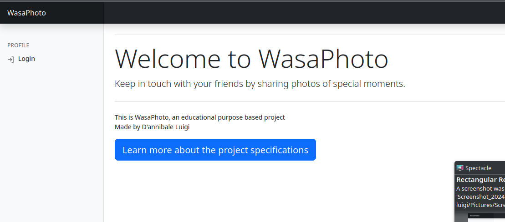
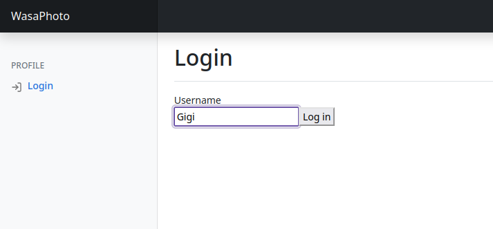
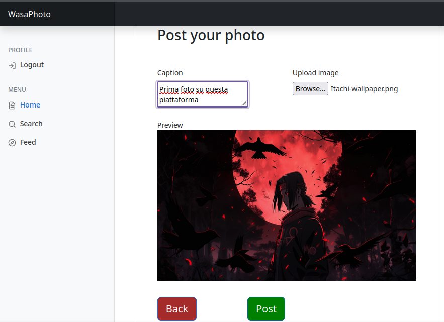

# WasaPhoto
Keep in touch with your friends by sharing photos of special moments, thanks to WASAPhoto! You can
upload your photos directly from your PC, and they will be visible to everyone following you.

## Table of contents
1. [Project specification](#project-specification)
3. [Demo images](#demo-images)
4. [Author](#author)

## Project specification
As part of the Web and Software Architecture exam, i had to:
1. define APIs using the OpenAPI standard
2. design and develop the server side (“backend”) in Go
3. design and develop the client side (“frontend”) in JavaScript
4. create a Docker container image for deployment

Moreover abour the [project specification](project-specification.pdf) can be found in the linked file.

## Immagini demo del gioco
 
 
 

## Author

* [Luigi D'annibale (Me)](https://luigidannibale.github.io)

